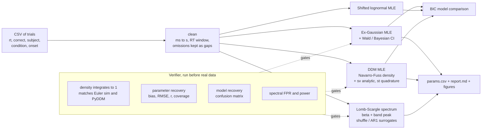
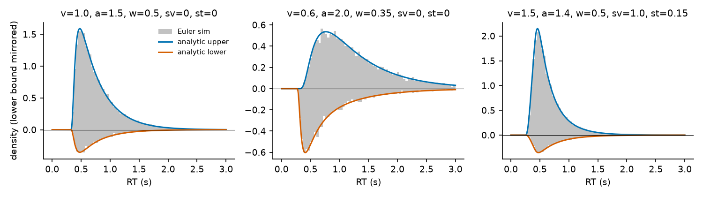
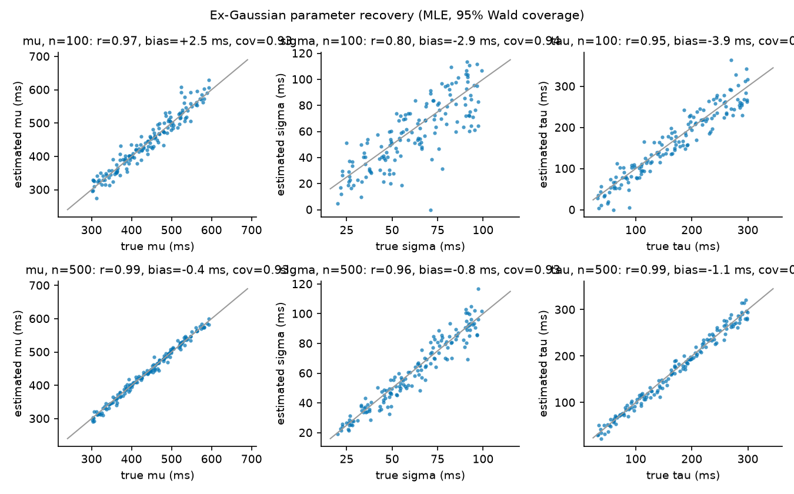
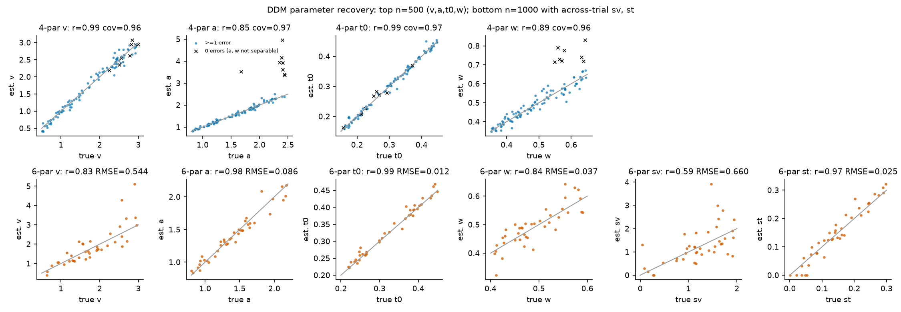
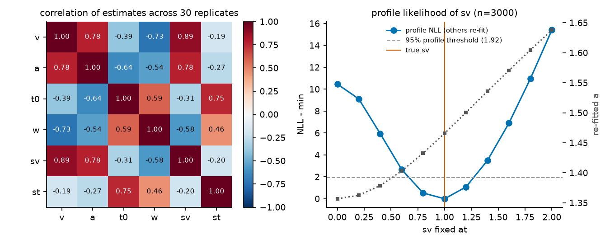
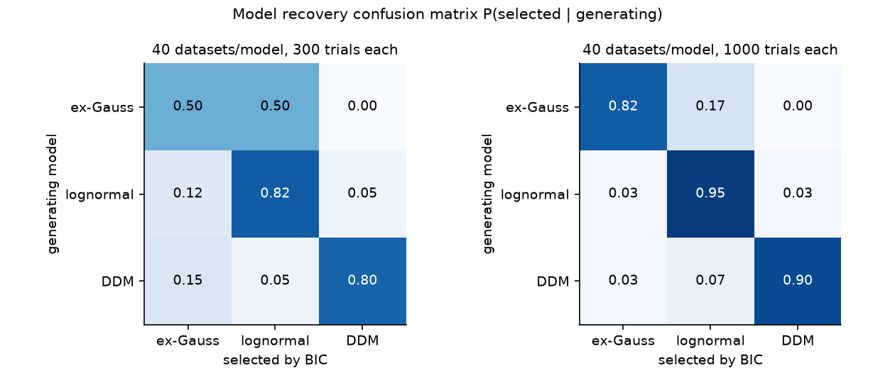
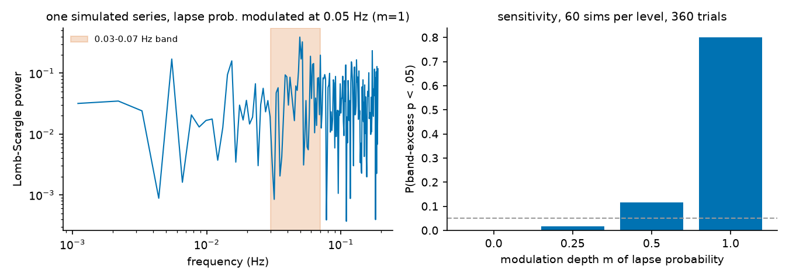
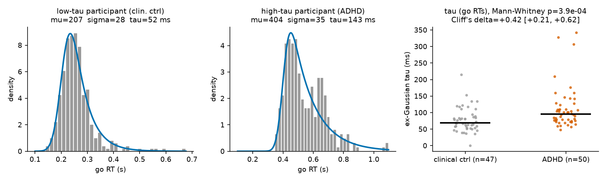
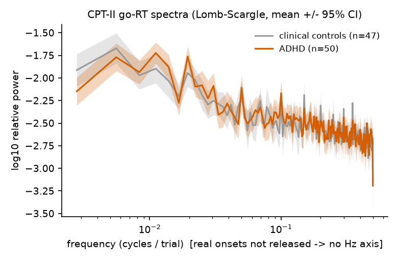
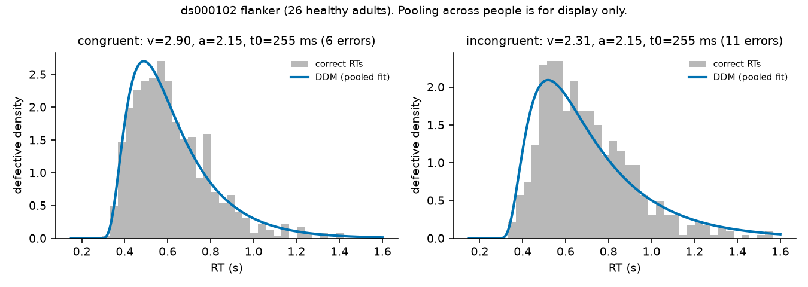

# taulapse

**Decomposing intra-individual reaction-time variability (IIRTV): ex-Gaussian, drift-diffusion and spectral models, each one checked by parameter recovery, model recovery and CI coverage before it touches real data.**

[](.github/workflows/ci.yml) · MIT · Python ≥ 3.10 · numpy/scipy only

The most robust behavioural finding in ADHD is not slow responding. It is *variable* responding: across 319 studies, children and adults with ADHD show larger intra-individual RT variability, with large effect sizes ([Kofler et al. 2013](https://doi.org/10.1016/j.cpr.2013.06.001)). The excess sits mostly in the slow tail of the RT distribution, i.e. occasional very slow responses usually read as attentional lapses ([Leth-Steensen et al. 2000](https://doi.org/10.1016/S0001-6918(00)00019-6); [Karalunas et al. 2014](https://doi.org/10.1111/jcpp.12217)). This repo implements the three standard ways to decompose that variability, all from scratch in numpy/scipy, and **refuses to trust any of them until it has shown it can recover known ground truth.**

| Question | Model | Lapse-relevant quantity |
|---|---|---|
| How heavy is the slow tail? | Ex-Gaussian (μ, σ, τ) | τ, the exponential tail |
| Is the tail from slow evidence accumulation, cautious bounds, or slow motor time? | Ratcliff drift-diffusion model (v, a, t₀, w, s_v, s_t) | v (drift), s_v (across-trial drift variability) |
| Do lapses recur on a slow clock (e.g. ~0.05 Hz)? | Lomb–Scargle / Welch spectra of the RT series | aperiodic slope β, band peak above aperiodic fit |

---

## Contents
- [Pipeline](#pipeline)
- [Math](#math)
- [Verifier: does any of this work?](#verifier-does-any-of-this-work)
- [Real data](#real-data)
- [What this does NOT claim](#what-this-does-not-claim)
- [Usage](#usage)
- [Reproduce every number](#reproduce-every-number)
- [Why I built this](#why-i-built-this)
- [References](#references)

## Pipeline



## Math

### Ex-Gaussian

An RT is the sum of a Gaussian and an independent exponential, $X = N + E$, with $N\sim\mathcal N(\mu,\sigma^2)$ and $E\sim\mathrm{Exp}(1/\tau)$:

$$
f(x\mid\mu,\sigma,\tau)=\frac{1}{\tau}\exp\!\left(\frac{\mu-x}{\tau}+\frac{\sigma^2}{2\tau^2}\right)\Phi\!\left(\frac{x-\mu}{\sigma}-\frac{\sigma}{\tau}\right),
\qquad \mathbb E[X]=\mu+\tau,\quad \mathrm{Var}[X]=\sigma^2+\tau^2 .
$$

The log-density is evaluated with $\log\Phi$ (`scipy.special.log_ndtr`), so it stays stable far in the tail. The log-likelihood $\ell(\theta)=\sum_i \log f(x_i\mid\theta)$ is maximised over $(\mu,\log\sigma,\log\tau)$, starting from method-of-moments values ([Lacouture & Cousineau 2008](https://doi.org/10.20982/tqmp.04.1.p035)). Wald intervals come from the observed information $\hat I=\nabla^2(-\ell)$ on the log scale and are then exponentiated. An optional Bayesian fit uses random-walk Metropolis with weakly informative, data-scaled priors.

Caveat: τ is a *descriptive* parameter. A τ difference does not by itself mean "lapses" in any mechanistic sense ([Matzke & Wagenmakers 2009](https://doi.org/10.3758/PBR.16.5.798); [Heathcote et al. 1991](https://doi.org/10.1037/0033-2909.109.2.340)).

### Drift-diffusion model

Evidence follows a Wiener process with drift between two absorbing bounds ([Ratcliff 1978](https://doi.org/10.1037/0033-295X.85.2.59); [Ratcliff & McKoon 2008](https://doi.org/10.1162/neco.2008.12-06-420)):

$$
dX_t = v\,dt + s\,dW_t,\qquad X_0 = w\,a,\qquad \text{respond when } X_t\in\{0,a\},\qquad RT = T_{\text{FPT}} + t_0 ,
$$

with the scaling convention $s=1$. Multiply $v$ and $a$ by $0.1$ to compare with the classic $s=0.1$ convention. The density of hitting the **lower** bound at decision time $t$ ([Navarro & Fuss 2009](https://doi.org/10.1016/j.jmp.2009.02.003)) is

$$
f_-(t\mid v,a,w)=\frac{1}{a^2}\exp\!\left(-v a w-\frac{v^2 t}{2}\right) g\!\left(\tfrac{t}{a^2}\,\middle|\,w\right),
$$

where the standardised density $g(u\mid w)$ has two equivalent series:

$$
g_{\text{small}}(u\mid w)=\frac{1}{\sqrt{2\pi u^3}}\sum_{k=-\infty}^{\infty}(w+2k)\exp\!\left(-\frac{(w+2k)^2}{2u}\right),
\qquad
g_{\text{large}}(u\mid w)=\pi\sum_{k=1}^{\infty}k\exp\!\left(-\frac{k^2\pi^2u}{2}\right)\sin(k\pi w).
$$

For each $u$ the code evaluates whichever series needs fewer terms to reach absolute error $\varepsilon=10^{-12}$, using the term-count bounds of Navarro & Fuss. The upper bound follows by symmetry: $f_+(t\mid v,a,w)=f_-(t\mid -v,a,1-w)$.

**Across-trial drift variability** $v_i\sim\mathcal N(v,s_v^2)$ integrates in closed form:

$$
f_-(t\mid v,s_v,a,w)=\frac{g(t/a^2\mid w)}{a^2\sqrt{1+s_v^2t}}\exp\!\left(\frac{s_v^2a^2w^2-2avw-v^2t}{2(1+s_v^2t)}\right).
$$

**Across-trial non-decision variability** $t_{0,i}\sim\mathcal U(t_0-\tfrac{s_t}{2},\,t_0+\tfrac{s_t}{2})$ is integrated with 24-point Gauss–Legendre quadrature, restricted to the part of the support where the integrand is non-zero (so the kink at $t=t_{0,i}$ never sits inside a quadrature panel).

The likelihood for trials $(rt_i,c_i)$ is $\ell=\sum_i\log f_{c_i}(rt_i-t_0)$, maximised with L-BFGS-B under box constraints. Starting values come from EZ-diffusion ([Wagenmakers et al. 2007](https://doi.org/10.3758/BF03194023)) plus jittered restarts. $t_0$ is parameterised as $t_{\min}=t_0-s_t/2<\min_i rt_i$, so every candidate point has a finite likelihood.

### Identifiability (what the data can and cannot tell apart)

- **Zero errors means $a$ and $w$ are not separately identified.** If every response hits the upper bound, the likelihood depends on the start-to-upper-bound distance $(1-w)a$ and barely on $a$ and $w$ individually. We observe exactly this in recovery (below).
- **$s_v$ trades off against $a$ and $v$.** A larger $s_v$ produces slow errors and a longer tail, which can be partly mimicked by a wider $a$ with a different $v$. Estimates are strongly correlated across replicate datasets (ρ(v, s_v) = 0.89, ρ(a, s_v) = 0.78), and the profile likelihood is wide even at n = 3000.
- **Ex-Gaussian vs shifted lognormal.** Both are right-skewed three-parameter families. At a few hundred trials they mimic each other, so model selection between them is close to a coin flip.

### Spectral structure

For an RT series $x_j$ observed at times $t_j$ (real onsets in s if available, otherwise trial index), after linear detrending we compute the Lomb–Scargle periodogram ([Lomb 1976](https://doi.org/10.1007/BF00648343); [Scargle 1982](https://doi.org/10.1086/160554)). It handles the gaps left by omissions and no-go trials without interpolation. From the periodogram:

$$
\log_{10}P(f)\approx c-\beta\log_{10}f \quad(\text{aperiodic slope }\beta),\qquad
E_{\text{band}}=\max_{f\in\text{band}}\Big[\log_{10}P(f)-(c-\beta\log_{10}f)\Big].
$$

- $\beta$ is tested against **trial-order shuffles**. These keep the RT distribution and destroy all serial structure.
- $E_{\text{band}}$ (a *peak* above the aperiodic fit) is tested against **AR(1) surrogates** with matched lag-1 autocorrelation. This null keeps generic red-noise slowness, which is the honest null for a claimed 0.05 Hz rhythm ([Sonuga-Barke & Castellanos 2007](https://doi.org/10.1016/j.neubiorev.2007.02.005)).

Welch's method ([Welch 1967](https://doi.org/10.1109/TAU.1967.1161901)) is also available for evenly sampled series.

## Verifier: does any of this work?

All numbers below come from `results/*.json`, produced by `scripts/`. Simulated data come from an **Euler–Maruyama simulator (dt = 10⁻⁴ s)**, never from the density being fitted.

### 1. The density itself (`scripts/01_density_checks.py`, `figures/ddm_density_vs_simulation.png`)

| Check | Result |
|---|---|
| ∫∫ joint density over (t, choice), 6 parameter sets incl. s_v and s_t | 1.000000 in every case |
| P(upper) vs closed form $\frac{1-e^{-2vaw}}{1-e^{-2va}}$ | equal to 6 decimals |
| KS distance vs 20 000 Euler trials, 3 parameter sets incl. s_v, s_t | 0.002–0.013 |
| KS (upper bound) as Euler dt shrinks 10⁻³ → 10⁻⁴ → 2·10⁻⁵ | 0.0144 → 0.0083 → 0.0045, so the residual is simulator discretisation, not the density |
| PyDDM ([Shinn et al. 2020](https://doi.org/10.7554/eLife.56938)) Crank–Nicolson solver, biased start w = 0.35, 0.6 | max abs density difference 3·10⁻⁵ to 4·10⁻⁴ (peak density ~0.4–1.2). PyDDM's *analytical* solver uses the same series, so its 10⁻⁹ agreement is expected and not an independent check |



### 2. Ex-Gaussian parameter recovery (`scripts/02_recovery_exgauss.py`)

150 random parameter sets: μ ∈ [300, 600] ms, σ ∈ [20, 100] ms, τ ∈ [30, 300] ms.

| n trials | param | bias (ms) | RMSE (ms) | r(true, est) | 95 % Wald coverage |
|---|---|---|---|---|---|
| 100 | μ | +2.5 | 21.2 | 0.97 | 0.93 |
| 100 | σ | −2.9 | 15.8 | 0.80 | 0.94 |
| 100 | τ | −3.9 | 25.9 | 0.95 | 0.96 |
| 500 | μ | −0.4 | 8.3 | 0.99 | 0.93 |
| 500 | σ | −0.8 | 6.3 | 0.96 | 0.93 |
| 500 | τ | −1.1 | 10.1 | 0.99 | 0.97 |

Estimation errors are correlated: ρ(err μ, err τ) ≈ −0.64 to −0.70 and ρ(err μ, err σ) ≈ +0.6. An over-estimated τ "steals" mean from μ, so **group differences in μ and τ are not independent pieces of evidence.** Bayesian 95 % credible intervals at n = 100 (60 datasets) cover 0.95 / 0.97 / 0.95 for μ / σ / τ.



### 3. DDM parameter recovery (`scripts/03_recovery_ddm.py`)

**4-parameter model** (v, a, t₀, w), 100 sets, n = 500: v ∈ [0.5, 3], a ∈ [0.8, 2.5], t₀ ∈ [0.15, 0.45], w ∈ [0.35, 0.65].

| param | all 100 sets: r / RMSE / coverage | 81 sets with ≥ 5 errors: r / RMSE / coverage |
|---|---|---|
| v | 0.99 / 0.113 / 0.96 | 0.99 / 0.098 / 0.96 |
| a | **0.85** / **0.464** / 0.97 | 0.99 / 0.053 / 0.96 |
| t₀ | 0.99 / 0.009 s / 0.97 | 1.00 / 0.007 s / 0.98 |
| w | 0.89 / 0.053 / 0.96 | 0.98 / 0.019 / 0.95 |

The 8 datasets with **zero errors** account for all of the damage to a and w. In those, a is over-estimated by +1.55 on average, but the identified combination $(1-w)a$ is recovered (RMSE 0.056, r = 0.94). The Wald intervals for a blow up appropriately in those cases (coverage 8/8, CI width ≈ 40–390), so the CI warns about the problem rather than hiding it.

**6-parameter model** (+ s_v, s_t), 40 sets, n = 1000:

| | v | a | t₀ | w | s_v | s_t |
|---|---|---|---|---|---|---|
| r | 0.83 | 0.98 | 0.99 | 0.84 | **0.59** | 0.97 |
| RMSE | 0.54 | 0.086 | 0.012 | 0.037 | **0.66** | 0.025 |

**Across-trial drift variability s_v is the weakest-recovered parameter.** At one fixed truth (v = 1.5, a = 1.5, s_v = 1.0, s_t = 0.15; 30 replicates, n = 1000) the mean estimate is 0.95 with SD 0.27, and its estimate correlates 0.89 with v and 0.78 with a. On one n = 3000 dataset, the 95 % profile interval is roughly s_v ∈ [0.65, 1.3] (interpolated on a 0.2 grid), and re-fitted a rises monotonically along the profile (1.36 → 1.64). This matters for ADHD, where "more drift variability" is a popular mechanistic reading of IIRTV: **at typical clinical trial counts, s_v alone should not carry a group comparison.**




### 4. Model recovery (`scripts/04_model_recovery.py`)

40 datasets per generating model. Descriptive models get an independent Bernoulli choice so all three have 4 parameters and are compared by BIC.

| generating ↓ / selected → | ex-Gauss | lognormal | DDM |
|---|---|---|---|
| **n = 300** ex-Gauss | 0.50 | 0.50 | 0.00 |
| lognormal | 0.13 | 0.83 | 0.05 |
| DDM | 0.15 | 0.05 | 0.80 |
| **n = 1000** ex-Gauss | 0.83 | 0.18 | 0.00 |
| lognormal | 0.03 | 0.95 | 0.03 |
| DDM | 0.03 | 0.08 | 0.90 |

At 300 trials, BIC cannot tell an ex-Gaussian from a shifted lognormal. "Ex-Gaussian fits better" claims at clinical trial counts deserve suspicion.



### 5. Spectral pipeline (`scripts/05_spectral_validation.py`)

Simulated 360-trial sessions with irregular SOA (U[1, 4] s, ~15 min) and 5 % omissions. 60 simulations per condition, 99 surrogates each.

| condition | P(p < .05), slope β (shuffle null) | P(p < .05), 0.03–0.07 Hz peak (AR(1) null) |
|---|---|---|
| white noise | 0.07 | 0.05 |
| AR(1), φ = 0.6 (no oscillation) | 0.90 (correct: there *is* serial structure) | 0.00 |
| lapse prob. modulated at 0.05 Hz, depth m = 0.25 / 0.5 / 1.0 | – | 0.02 / 0.12 / **0.80** |

Design note: the first version averaged the residual over the band and had essentially no power (0.08 at m = 1). A narrow-band rhythm occupies 1–2 bins and averaging over ~40 bins dilutes it. The peak (max) statistic replaced it, and both are reported in `results/spectral_validation.json`. **Even so, a 0.05 Hz rhythm in lapse probability is detectable in a single 15-minute session only if it is very strong** (lapse probability swinging between 0 and 2× its mean).



## Real data

Data are **not** redistributed here. `scripts/fetch_data.py` downloads them from the original hosts and records SHA-256 checksums.

### HYPERAKTIV: adult ADHD vs clinical controls, Conners' CPT-II (go/no-go)

- **Source:** [Hicks et al. 2021](https://doi.org/10.1145/3458305.3478454), OSF project [3agwr](https://osf.io/3agwr/). 103 adult psychiatric outpatients. 51 have ADHD; 52 are **clinical controls**, i.e. patients with other diagnoses (mood, anxiety…), *not* healthy volunteers. 99 have trial-level CPT-II data (360 trials).
- **License:** the OSF metadata says **CC-BY 4.0**, but the project wiki adds: *"The use of the dataset for purposes such as competitions and commercial purposes needs prior written permission."* Treat commercial use as requiring permission from the authors.
- **Coding (inferred, not documented):** the stimulus code `0` occurs on exactly 36/360 trials for every participant and is answered on 44.5 % of trials, vs 95.7 % for all other codes. It is therefore the CPT-II "X" (no-go) and all other codes are go trials. Responses are RTs in ms, with −1 meaning no response. Go RTs < 100 ms are dropped as anticipations. Two sessions contain no responses at all and were excluded, which leaves **50 ADHD vs 47 controls**, median 320 go RTs each.
- **Pre-specified primary outcome:** ex-Gaussian τ of go RTs. The 7 secondary outcomes are Holm-corrected.

| outcome | median ADHD | median ctrl | Cliff's δ [95 % bootstrap CI] | Mann–Whitney p | Holm p |
|---|---|---|---|---|---|
| **τ (ms)** | **95.8** | **69.3** | **+0.42 [+0.21, +0.62]** | **0.0004** | (primary) |
| μ (ms) | 255.6 | 302.6 | −0.41 [−0.62, −0.19] | 0.0005 | 0.002 |
| σ (ms) | 38.4 | 39.8 | −0.03 [−0.27, +0.19] | 0.77 | 1.0 |
| RT SD (ms) | 114.2 | 92.1 | +0.41 [+0.20, +0.60] | 0.0005 | 0.002 |
| RT CV | 0.307 | 0.233 | +0.55 [+0.35, +0.72] | < 10⁻⁴ | < 0.001 |
| omissions (%) | 1.70 | 0.31 | +0.49 [+0.29, +0.67] | < 10⁻⁴ | < 0.001 |
| commissions (%) | 56.9 | 33.3 | +0.46 [+0.24, +0.66] | 0.0001 | < 0.001 |
| spectral slope β | 0.40 | 0.39 | +0.07 [−0.16, +0.31] | 0.56 | 1.0 |

Dimensionally, across all participants, τ correlates with adult ADHD self-report: ASRS ρ = 0.29 (p = 0.006, n = 90) and WURS (childhood retrospective) ρ = 0.41 (p < 10⁻⁴, n = 92). RT CV correlates more strongly: ρ = 0.46 and 0.49.

The pattern is the textbook one. The ADHD group is **not slower**; its Gaussian component is actually *faster*, with more commissions, which suggests a less cautious speed-accuracy setting. The excess variability lives in the exponential tail τ and in the CV. Caveats:

1. Controls are psychiatric patients, so this is ADHD vs other psychopathology, not ADHD vs health.
2. Age and sex are not adjusted for.
3. The CPT-II may itself have been part of the clinical assessment that produced the ADHD label (criterion contamination). The dataset does not let us rule this out.
4. Only one participant in the ADHD group is coded as on stimulants (as coded in `patient_info.csv`, which has many blanks).
5. The fast-μ / high-τ pattern partly reflects the negative μ–τ estimation-error correlation shown in recovery. The two effects are not independent evidence.



**Spectra: the 0.05 Hz hypothesis cannot be tested here.** Per-trial onset times are not released, so the spectra are in cycles/trial, not Hz. Almost every participant shows significant serial structure (β > shuffle null in 45/50 ADHD and 45/47 controls), but β does not differ between groups (δ = +0.07). Both groups' spectra show peaks at ≈ 0.017, 0.05 and 0.1 cycles/trial. These frequencies match the CPT-II design as usually described: the inter-stimulus interval (1, 2 or 4 s) changes every 20 trials within 60-trial blocks, giving 1/60, 1/20 and its harmonic. So the peaks are most plausibly a **task artefact, not a brain rhythm**. We could not confirm this against per-trial timing, which the release does not include. This is a concrete example of why a spectral peak in RTs is not, by itself, evidence for default-mode interference. Note also that [Karalunas et al. 2013](https://doi.org/10.1111/jcpp.12028) found that children with ADHD show excess RT variability in a faster frequency band equivalent to the low-frequency excess, so the effect is not confined to low frequencies.



### OpenNeuro ds000102: two-choice flanker, healthy adults (DDM demonstration)

- **Source:** [Kelly et al. 2008](https://doi.org/10.1016/j.neuroimage.2007.08.008), OpenNeuro [ds000102](https://openneuro.org/datasets/ds000102). License **PDDL** (public domain). 26 participants × 48 trials, accuracy 98.6 % (17 errors in total).
- **Model:** accuracy-coded DDM, one drift per condition, shared a and t₀, w fixed at 0.5. Fitted per participant.
- **Results:** drift is lower for incongruent than congruent flankers in **26/26** participants (median 3.70 vs 4.55, Wilcoxon p = 3·10⁻⁸), and the flanker RT effect is 74 ms. **But** with ~0–2 errors per person, a is unidentified in 7/26 participants (estimate at the bound a = 5), and the median 95 % CI width for v_incongruent is 3.2. This is the zero-error problem from the recovery study, now on real data. The figure shows a pooled fit, for display only. The standard DDM misfits the incongruent leading edge, a known limitation that motivates flanker-specific models (shrinking spotlight, DSTP), which are not implemented here.
- The SOA is 10–22 s, so the RT series' Nyquist frequency is ≤ 0.05 Hz: **this dataset cannot test a 0.05 Hz rhythm either.**



### Still pending

An ADHD-labeled **two-choice** dataset with enough trials and errors per person for a DDM comparison, and an ADHD dataset **with real trial onsets** for an honest 0.05 Hz test, are both pending. The two datasets used here are what we could find with clear open access.

## What this does NOT claim

- **Not diagnostic.** No parameter here classifies an individual as having ADHD. Group effects of δ ≈ 0.4 imply heavy overlap between distributions (see the τ strip plot). The comparison group is psychiatric patients, and the result is a single-dataset association.
- **τ ≠ "lapses" by construction.** τ is a descriptive tail parameter. Its mechanistic reading needs a process model, and the DDM-based reading (s_v, v) is the least identifiable part of that model at clinical trial counts.
- **No evidence here for or against a 0.05 Hz default-mode rhythm.** Neither dataset has the timing information needed. Our simulations show that a single 15-minute session detects such a rhythm only if it is strong, and real task structure produces spectral peaks of its own.
- **No hierarchical model.** Fits are per participant (MLE). Hierarchical Bayesian DDM ([HDDM, Wiecki et al. 2013](https://doi.org/10.3389/fninf.2013.00014)) would shrink noisy individual estimates and is the natural next step.
- **No contaminant model by default.** Fast guesses and attention-unrelated slow outliers are handled by RT windows, not by a mixture ([Ratcliff & Tuerlinckx 2002](https://doi.org/10.3758/BF03196302)).

## Usage

```bash
python -m venv .venv && .venv/bin/pip install -e ".[dev]"

# one row per trial; rt in s or ms (auto-detected); optional: correct, subject, condition, onset
taulapse simulate --model ddm --n 400 --out demo.csv
taulapse fit demo.csv --out report/                       # ex-Gaussian + lognormal + DDM + spectrum
taulapse fit my.csv --rt-col rt_ms --subject-col id --models exgauss --min-rt 0.1
taulapse fit flanker.csv --condition-col congruency --sv --st   # condition-specific drift, full DDM
```

Output: `report/params.csv` (one row per subject, with estimates and 95 % CIs), `report/report.md`, and `report/fit_<subject>.png`.

```python
from taulapse import exgauss, ddm
fit = exgauss.fit(rts)                  # .mu .sigma .tau .ci['tau'] .bic
dd  = ddm.fit(rt, correct, fit_sv=True)  # .params .ci .loglik
```

## Reproduce every number

```bash
bash scripts/run_all.sh     # sequential, single process; ~15–40 min on a laptop, < 300 MB RAM
pytest -q                   # 25 tests: normalisation, series agreement, Euler vs density, recovery
```

`scripts/verify_dois.py` checks every DOI in this README against Crossref and writes the result to `results/dois.json`.

<!-- TODO(Tommaso): dictate 3-4 lines in your own words -->

## References

All DOIs were verified against Crossref (`results/dois.json`).

- Hicks, S. A. et al. (2021). HYPERAKTIV: An activity dataset from patients with ADHD. *MMSys '21*. https://doi.org/10.1145/3458305.3478454
- Huang-Pollock, C. L. et al. (2012). Evaluating vigilance deficits in ADHD: a meta-analysis of CPT performance. *J Abnorm Psychol*. https://doi.org/10.1037/a0027205
- Karalunas, S. L., Huang-Pollock, C. L., & Nigg, J. T. (2012). Decomposing ADHD-related effects in response speed and variability. *Neuropsychology*. https://doi.org/10.1037/a0029936
- Karalunas, S. L., Huang-Pollock, C. L., & Nigg, J. T. (2013). Is reaction time variability in ADHD mainly at low frequencies? *J Child Psychol Psychiatry*. https://doi.org/10.1111/jcpp.12028
- Karalunas, S. L. et al. (2014). Annual Research Review: Reaction time variability in ADHD and autism. *J Child Psychol Psychiatry*. https://doi.org/10.1111/jcpp.12217
- Kelly, A. M. C. et al. (2008). Competition between functional brain networks mediates behavioral variability. *NeuroImage*. https://doi.org/10.1016/j.neuroimage.2007.08.008
- Kofler, M. J. et al. (2013). Reaction time variability in ADHD: a meta-analytic review of 319 studies. *Clin Psychol Rev*. https://doi.org/10.1016/j.cpr.2013.06.001
- Castellanos, F. X. et al. (2005). Varieties of ADHD-related intra-individual variability. *Biol Psychiatry*. https://doi.org/10.1016/j.biopsych.2004.12.005
- Heathcote, A., Popiel, S. J., & Mewhort, D. J. K. (1991). Analysis of response time distributions: an example using the Stroop task. *Psychol Bull*. https://doi.org/10.1037/0033-2909.109.2.340
- Lacouture, Y., & Cousineau, D. (2008). How to use MATLAB to fit the ex-Gaussian. *TQMP*. https://doi.org/10.20982/tqmp.04.1.p035
- Leth-Steensen, C., Elbaz, Z. K., & Douglas, V. I. (2000). Mean response times, variability, and skew in the responding of ADHD children. *Acta Psychol*. https://doi.org/10.1016/S0001-6918(00)00019-6
- Lomb, N. R. (1976). Least-squares frequency analysis of unequally spaced data. *Astrophys Space Sci*. https://doi.org/10.1007/BF00648343
- Matzke, D., & Wagenmakers, E.-J. (2009). Psychological interpretation of the ex-Gaussian and shifted Wald parameters. *Psychon Bull Rev*. https://doi.org/10.3758/PBR.16.5.798
- Mulder, M. J. et al. (2010). Basic impairments in regulating the speed-accuracy tradeoff predict symptoms of ADHD. *Biol Psychiatry*. https://doi.org/10.1016/j.biopsych.2010.07.031
- Navarro, D. J., & Fuss, I. G. (2009). Fast and accurate calculations for first-passage times in Wiener diffusion models. *J Math Psychol*. https://doi.org/10.1016/j.jmp.2009.02.003
- Gondan, M., Blurton, S. P., & Kesselmeier, M. (2014). Even faster and even more accurate first-passage time densities for the Wiener diffusion model. *J Math Psychol*. https://doi.org/10.1016/j.jmp.2014.05.002
- Ratcliff, R. (1978). A theory of memory retrieval. *Psychol Rev*. https://doi.org/10.1037/0033-295X.85.2.59
- Ratcliff, R., & McKoon, G. (2008). The diffusion decision model. *Neural Comput*. https://doi.org/10.1162/neco.2008.12-06-420
- Ratcliff, R., & Tuerlinckx, F. (2002). Estimating parameters of the diffusion model. *Psychon Bull Rev*. https://doi.org/10.3758/BF03196302
- Scargle, J. D. (1982). Studies in astronomical time series analysis II. *ApJ*. https://doi.org/10.1086/160554
- Shinn, M., Lam, N. H., & Murray, J. D. (2020). A flexible framework for simulating and fitting generalized drift-diffusion models (PyDDM). *eLife*. https://doi.org/10.7554/eLife.56938
- Sonuga-Barke, E. J. S., & Castellanos, F. X. (2007). Spontaneous attentional fluctuations in impaired states and pathological conditions: a neurobiological hypothesis. *Neurosci Biobehav Rev*. https://doi.org/10.1016/j.neubiorev.2007.02.005
- Vaurio, R. G., Simmonds, D. J., & Mostofsky, S. H. (2009). Increased intra-individual RT variability in ADHD across response inhibition tasks. *Neuropsychologia*. https://doi.org/10.1016/j.neuropsychologia.2009.01.022
- Wagenmakers, E.-J., van der Maas, H. L. J., & Grasman, R. P. P. P. (2007). An EZ-diffusion model for response time and accuracy. *Psychon Bull Rev*. https://doi.org/10.3758/BF03194023
- Welch, P. (1967). The use of FFT for the estimation of power spectra. *IEEE Trans Audio Electroacoust*. https://doi.org/10.1109/TAU.1967.1161901
- Wiecki, T. V., Sofer, I., & Frank, M. J. (2013). HDDM: Hierarchical Bayesian estimation of the DDM in Python. *Front Neuroinform*. https://doi.org/10.3389/fninf.2013.00014
- Wilson, R. C., & Collins, A. G. E. (2019). Ten simple rules for the computational modeling of behavioral data. *eLife*. https://doi.org/10.7554/eLife.49547
- Ziegler, S. et al. (2016). Modelling ADHD: a review of ADHD theories through their predictions for computational models. *Neurosci Biobehav Rev*. https://doi.org/10.1016/j.neubiorev.2016.09.002
